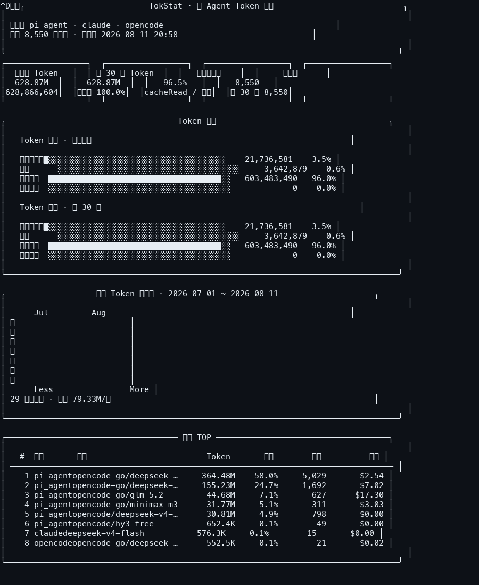

# TokStat

全 Agent 会话 Token 用量统计 CLI。自动发现并解析本机所有编码 Agent 的用量日志（pi-agent、Codex、Claude Code、OpenCode、Gemini CLI、Kimi、Grok、Hermes、Mimocode、Copilot CLI），输出一张终端统计面板：**至今总 Token、近 30 天 Token、输入 / 输出 / 缓存命中 Token、缓存命中率、GitHub 风格每日热力图、模型排行**。

统计口径与 [Tokdash](https://github.com/Shiorangerin/Tokdash) 的各解析器保持一致。



## 支持的 Agent 数据源

| 源 | 数据位置 | 格式 |
| --- | --- | --- |
| pi_agent | `~/.pi/agent/sessions/**/*.jsonl` | JSONL（`PI_AGENT_DIR` 可覆盖） |
| codex | `~/.codex/sessions/**/*.jsonl` | JSONL token_count 事件 |
| claude | `~/.claude*/projects/**/*.jsonl` | JSONL streaming usage |
| opencode | `~/.local/share/opencode/opencode.db` | SQLite |
| gemini_cli | `~/.gemini/tmp/*/chats/session-*` | JSON / JSONL |
| kimi | `~/.kimi` + `~/.kimi-code` | wire.jsonl（两种 schema） |
| grok | `$GROK_HOME/logs/unified.jsonl` | JSONL |
| hermes | `~/.hermes/state.db` | SQLite |
| mimo | `~/.local/share/mimocode/mimocode.db` | SQLite |
| copilot_cli | `~/.copilot/otel/*.jsonl` + `events.jsonl` | OTel JSONL |

默认自动扫描所有存在的数据源并按源去重汇总；`--dir` 会按目录名自动路由到对应解析器。

## 功能

- 📊 至今为止的总 Token、近 30 天总 Token（滚动窗口）
- 🔀 输入 / 输出 / 缓存命中 / 缓存写入 Token 拆分与占比条
- 🎯 缓存命中率（`cacheRead / (tokens_in + cacheRead)`，token 加权）
- 🔥 GitHub 风格每日 Token 热力图（颜色自适应终端宽度，无颜色终端自动降级为密度字符）
- 🏆 模型 TOP 排行（含消息数与费用）
- 📥 支持 `--stdin` 从管道读取 JSONL，支持 `PI_AGENT_DIR` 环境变量
- 🪟 原生 Windows 支持（自动启用 VT 与 UTF-8 输出）

## 统计口径

与 Tokdash 完全一致：

- 只统计 `type=message` 且 `role=assistant` 且带 `usage` 的行，按 `(会话 id, 消息 id)` 去重（跨文件）
- `tokens_in = input + cacheWrite`（缓存写入属计费输入）
- 单条总 Token = `tokens_in + output + cacheRead`（+ reasoning）
- 兜底：细分全为 0 但 `totalTokens > 0` 时全部记入输出
- 缓存命中率 = `cacheRead / (tokens_in + cacheRead)`，分母为 0 显示 `n/a`

## 安装

复制下面的代码块发给 AI 代装：

````markdown
```bash
# macOS / Linux
brew install rust  # 若没有 Rust 工具链
git clone https://github.com/Shiorangerin/tokstat.git
cd tokstat
cargo build --release
# 将 target/release/tokstat 加入 PATH，或：
#   cargo install --path .
```
````

Windows：安装 Rust（[rustup.rs](https://rustup.rs)）后在项目目录执行 `cargo build --release`，产物在 `target\release\tokstat.exe`。也可直接下载 [Releases](../../releases) 里的预编译 exe。

## 用法

```text
tokstat                 自动扫描全部 Agent 数据源并输出统计页
tokstat --dir <DIR>     扫描指定目录/文件（按路径自动识别来源，可重复指定）
tokstat --stdin         从标准输入逐行读取 JSONL 会话日志（pi 格式）
tokstat --days <N>      热力图时间跨度上限天数，默认 365（实际窗口自适应数据跨度）
tokstat --no-color      禁用颜色输出
tokstat -h, --help      显示帮助
tokstat -V, --version   显示版本
```

环境变量：

| 变量 | 说明 |
| --- | --- |
| `PI_AGENT_DIR` | 逗号分隔的 pi-agent 会话日志根目录列表 |
| `KIMI_CODE_HOME` / `KIMI_SHARE_DIR` / `GROK_HOME` / `HERMES_HOME` | 对应源的数据根目录 |
| `COPILOT_OTEL_FILE_EXPORTER_PATH` | Copilot OTel 单文件导出路径 |
| `NO_COLOR` | 设置后禁用颜色 |

## 运行示例

```text
╭───────────────────────── TokStat · 全 Agent Token 统计 ──────────────────────────╮
│                                                                                    │
│ 数据源 pi_agent · claude · opencode                                               │
│ 统计 277 个会话文件 · 8,385 条消息 · 更新于 2026-08-11 20:24                        │
│                                                                                    │
╰──────────────────────────────────────────────────────────────────────────────────╯
┌─────────────────┐  ┌─────────────────┐  ┌─────────────────┐  ┌─────────────────┐
│  至今总 Token   │  │ 近 30 天 Token  │  │   缓存命中率    │  │     消息数      │
│     606.72M     │  │     606.72M     │  │      96.4%      │  │      8,385      │
│   606,718,333   │  │  占全时 100.0%  │  │cacheRead / 输入 │  │ 近 30 天 8,385  │
└─────────────────┘  └─────────────────┘  └─────────────────┘  └─────────────────┘
```

热力图在支持 24bit 颜色的终端上显示为 GitHub 贡献图风格的绿色方块；在不支持颜色的终端（管道、CI）中自动降级为 `░▒▓█` 密度字符。

## 技术栈

- 纯 Rust，依赖仅 `serde_json` + `chrono`（Windows 下额外 `windows-sys` 启用 VT）
- 无任何运行时依赖，静态编译，单文件分发

## License

MIT
